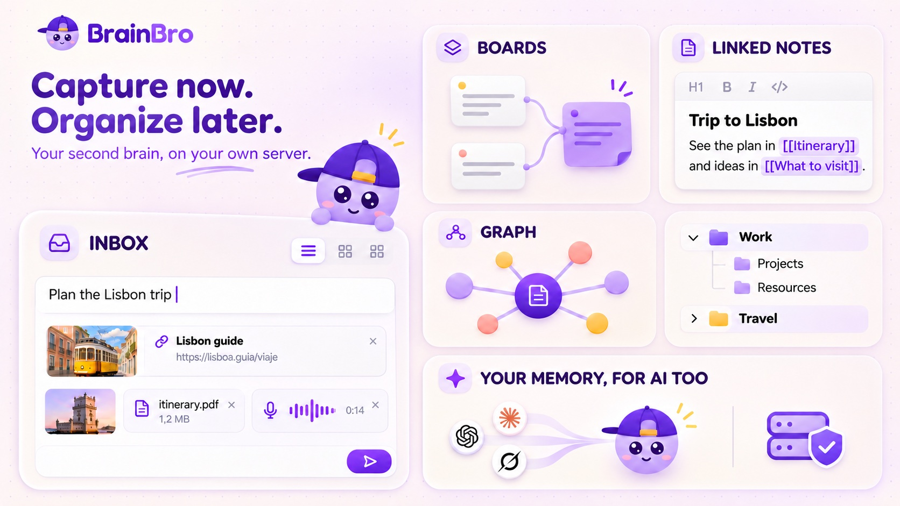

# BrainBro

A self-hosted second brain: capture links, notes, images and files with zero friction, then organize them into boards (infinite canvas) and collections.

> **Drop it now, sort it later.** Everything lands in the inbox; organizing is a separate step.

## What it does

- **Capture anything:** paste or drop links, notes, images, files and voice recordings, from
  the browser, your phone's share sheet ([pwa.md](docs/pwa.md)) or a Telegram bot
  ([telegram.md](docs/telegram.md)). Links get their previews in the background.
- **Notes** in Markdown, linked to each other with `[[Title]]` ([wikilinks.md](docs/wikilinks.md)),
  edited live from several devices at once, with their version history.
- **Boards:** infinite canvases where items are laid out in space ([boards.md](docs/boards.md)).
  **Collections** that nest, and a **graph** of how everything ties together.
- **Search** by words and by meaning, with a model that runs on your server
  ([search.md](docs/search.md)).
- **AI assistants** (Claude, ChatGPT and others) read from and write to it through MCP
  ([mcp.md](docs/mcp.md)).
- **Publish** a note as a public page, or a collection as a blog on your own domain
  ([public-notes.md](docs/public-notes.md), [blogs.md](docs/blogs.md)).
- **Your data stays yours:** import an Obsidian vault, export everything as Markdown and files
  ([import.md](docs/import.md), [export.md](docs/export.md)).
- Several people on one server, each with their own space, by invitation.

Every page of the documentation is listed in [docs/](docs/README.md).

## Self-hosting

### Requirements

- A machine with Docker and Docker Compose v2. The images are built for Linux on amd64 and arm64.
- About 600 MB of memory for semantic search, on top of the app and its database.
- For HTTPS, either a domain on Cloudflare (Cloudflare Tunnel, no open ports) or a public IP
  with ports 80 and 443 open (Caddy). Without HTTPS it works on your local network only.

### Install

```bash
mkdir brainbro && cd brainbro
curl -fsSLO https://raw.githubusercontent.com/TheBrainBro/brainbro/main/docker-compose.production.yml
curl -fsSL https://raw.githubusercontent.com/TheBrainBro/brainbro/main/stack.env.example -o stack.env
```

Edit `stack.env`: at least `APP_HOSTNAMES`, `SECRET_KEY` (`openssl rand -base64 48`),
`POSTGRES_PASSWORD` (`openssl rand -base64 32`), `ADMIN_USERNAME` and `ADMIN_PASSWORD`, and
`APP_HTTPS`, `APP_PROXY` and `APP_BIND` for the way you reach it. Then:

```bash
docker compose --env-file stack.env -f docker-compose.production.yml up -d
```

[docs/deployment.md](docs/deployment.md) has the three ways to reach it (Cloudflare Tunnel,
Caddy, local network only), every setting, and Umbrel.

### First user

The first deploy creates the admin user from `ADMIN_USERNAME` and `ADMIN_PASSWORD`: sign in
with them. To add other people, create an invitation link in Settings → Invitations.

### Backups

The worker dumps the database every day at 04:00 and keeps the last 14 (`BACKUP_RETENTION`). They live on the same
disk, so copy them somewhere else, together with the uploaded files:
[docs/backups.md](docs/backups.md).

### Upgrading

```bash
docker compose --env-file stack.env -f docker-compose.production.yml pull
docker compose --env-file stack.env -f docker-compose.production.yml up -d
```

The database is backed up before any migration, and migrated on its own.

## Stack

| Part | Technology |
|---|---|
| Backend | Django 6 + DRF, Celery + Redis |
| Database | Postgres 17 with pgvector |
| Frontend | Vite + React + TypeScript + Tailwind (React Flow for the canvas) |
| Auth | Django sessions |
| Deployment | Docker Compose, images on GHCR |

## Contributing

[CONTRIBUTING.md](CONTRIBUTING.md) covers the development setup, tests and checks, and the
commit and pull request conventions. External contributions need a signed
[Contributor License Agreement](CLA.md): the CLA Assistant bot asks for it on your first
pull request. Everyone taking part follows the [Code of Conduct](CODE_OF_CONDUCT.md).

## License

The code is licensed under the [GNU AGPL v3](LICENSE) (`AGPL-3.0-only`). The BrainBro
name, logo and mascot are not covered by it: see [TRADEMARKS.md](TRADEMARKS.md) for what is
allowed. Files from other projects keep their own licenses, listed in
[THIRD_PARTY_NOTICES.md](THIRD_PARTY_NOTICES.md).
